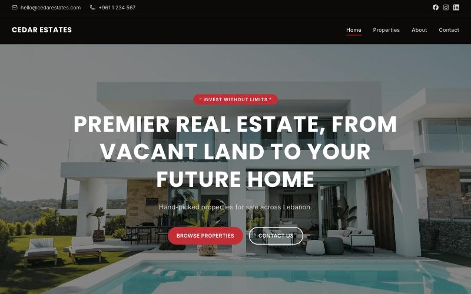
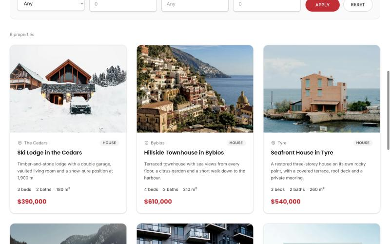
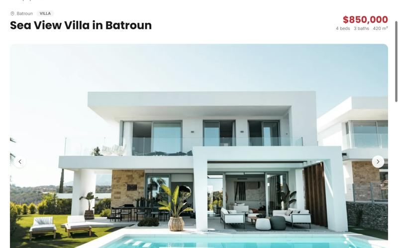

# Django Real Estate

[](https://github.com/GeBakaev/django-real-estate/actions/workflows/ci.yml)

A property-listing website for a small real estate agency. Visitors browse, search and filter
listings, look through photo galleries and maps, and send inquiries. The agent manages
listings, photos and all site text from the Django admin, without touching code.

Built with Django 5.2, Tailwind CSS 4 and htmx. Runs with Docker Compose (uWSGI, nginx,
PostgreSQL) or on its own with SQLite for development.



| Listings with filters | Listing page with gallery |
| --- | --- |
|  |  |

Photos in the screenshots and under `static/images/` are from Unsplash; see
[`static/images/CREDITS.md`](static/images/CREDITS.md).

## Features

**Public site**

- Listings with type, price, area, bedrooms and bathrooms, location, description and any
  number of photos.
- Listings for sale or for rent; rentals show their price per month or per year, which is
  also the minimum term.
- Properties page with search, filters (sale or rent, location, type, bedrooms, price range,
  minimum area), sorting and pagination. Results update in place with htmx; every filter state is a plain
  URL that also works without JavaScript.
- Listing page with a photo gallery (thumbnails, arrows, keyboard and swipe), key facts, a map
  (OpenStreetMap via Leaflet, no API key) and an inquiry form tied to that property.
- Contact form on the home and contact pages. Inquiries are stored in the admin and, when
  configured, emailed to the owner with the sender as Reply-To and a link to the property
  they came from.
- Optional WhatsApp button on listing pages, opening a chat with the property's name and link
  already typed. It appears once a WhatsApp number is set in the admin.
- Responsive layout, dark header and footer, toast messages, no CSS or JS framework at runtime
  beyond the compiled Tailwind stylesheet and htmx on the listings page.
- Search-engine basics: `sitemap.xml`, `robots.txt`, canonical links, Open Graph and Twitter
  tags with the listing's cover photo.

**Admin**

- Listings with inline photos; pick the cover photo, set coordinates by clicking a map.
- Site information in one place: name, contact details, social links, about text and
  the three statistics shown on the About page.
- Inquiries are read-only records with the sender's details and the property they asked about.

**Behind the scenes**

- Uploaded photos are resized to WebP in three sizes (gallery, card, thumbnail) on save; old
  files are removed when a photo is replaced or deleted.
- Static files get hashed names so long browser caches never serve a stale stylesheet.
- All configuration comes from environment variables; `USE_HTTPS=1` turns on secure cookies,
  HSTS and the HTTPS redirect.
- A test suite, ruff lint and format, GitHub Actions CI that also checks the compiled
  stylesheet is current, and Dependabot for Python and Actions updates.

## Quick start with Docker

1. Copy `.sample.env` to `.env` and edit it (see [Configuration](#configuration)). At minimum
   set `SECRET_KEY`, the database password and the initial admin password.
2. Start everything:

   ```bash
   docker compose up --build
   ```

   On start the web container waits for PostgreSQL, applies migrations, collects static files
   and creates the admin user if it does not exist. nginx serves the site on port 80 and the
   static and media files directly.
3. Open http://localhost and sign in at http://localhost/admin with the admin credentials from
   `.env`. Fill in **Website info**, then add listings.

If you already have photos from before the resized versions existed, generate them once:

```bash
docker compose exec web python manage.py make_thumbnails
```

## Local development without Docker

```bash
python -m venv .venv
.venv/bin/pip install -r requirements-dev.txt
.venv/bin/python manage.py migrate
.venv/bin/python manage.py createsuperuser
DEBUG=1 .venv/bin/python manage.py runserver
```

Without a `.env` the app uses SQLite, a development secret key and prints outgoing email to
the console. `DEBUG=1` is needed for `runserver` to serve static and media files.

### Everyday commands

```bash
.venv/bin/python manage.py test          # run the test suite (SQLite, no .env needed)
.venv/bin/ruff check . && .venv/bin/ruff format .
scripts/tailwind                         # rebuild static/css/site.css after template changes
scripts/tailwind --watch                 # rebuild continuously while editing
```

The stylesheet is compiled from `tailwind/site.css` with the Tailwind standalone CLI, which
`scripts/tailwind` downloads (pinned and checksum-verified) into the git-ignored `.tailwind/`
on first use. No Node or npm. The compiled `static/css/site.css` is committed so deployments
need no build step; CI fails if it is out of date.

## Configuration

Everything is read from the environment (`.env` with Docker Compose). `.sample.env` lists
every variable with comments.

| Variable | Default | Purpose |
| --- | --- | --- |
| `SECRET_KEY` | insecure dev key | Django secret. Generate one with `python -c "import secrets; print(secrets.token_urlsafe())"`. |
| `DEBUG` | `0` | `1` for development only. |
| `DJANGO_ALLOWED_HOSTS` | `localhost,127.0.0.1` | Comma-separated hostnames the site is served on. |
| `CSRF_TRUSTED_ORIGINS` | empty | Comma-separated origins such as `https://example.com`. |
| `USE_HTTPS` | `0` | `1` behind TLS: secure cookies, HSTS, HTTP to HTTPS redirect. |
| `SQL_ENGINE` | SQLite | `django.db.backends.postgresql` with Docker. |
| `POSTGRES_DB`, `POSTGRES_USER`, `POSTGRES_PASSWORD`, `POSTGRES_HOST`, `POSTGRES_PORT` | | Database connection; also used by the `db` container. |
| `DJANGO_ADMIN_USERNAME`, `DJANGO_ADMIN_EMAIL`, `DJANGO_ADMIN_PASSWORD` | `admin`, empty, empty | Initial superuser, created on first start. Leave the password empty to skip. |
| `EMAIL_HOST`, `EMAIL_PORT`, `EMAIL_USE_TLS`, `EMAIL_HOST_USER`, `EMAIL_HOST_PASSWORD` | `localhost`, `587`, `1`, empty, empty | SMTP server for outgoing mail. |
| `DEFAULT_FROM_EMAIL` | `noreply@localhost` | Sender address. |
| `CONTACT_NOTIFY_EMAILS` | empty | Comma-separated recipients of contact-form inquiries. Empty disables the notification; inquiries are always kept in the admin. |
| `EMAIL_BACKEND` | console when `DEBUG=1`, SMTP otherwise | Override the mail backend. |

## Managing content

Everything visible on the site is edited at `/admin`:

- **Website info** holds the site name, contact email and phone, the optional WhatsApp number,
  social links, location, the home page headline and tagline, the About heading and text, and
  the property, city and office counts. There is exactly one record.
- **Listings** are drafts until their status is set to Published; drafts are never shown
  publicly. Photos are added inline; tick **Default** on the one to use as the cover. Click the
  map in the Location section to set coordinates, or type them.
- **Contacts** lists inquiries from the contact form and from listing pages, with the property
  each one is about.

## Project layout

```
real_estate/      settings, URL root, static-files storage
listings/         models, views, forms, admin, sitemaps, email, management commands, tests
templates/        base layout, pages, partials/ (cards, forms, gallery, nav, footer), icons/
tailwind/         Tailwind source stylesheet
static/           compiled stylesheet, images, gallery script
nginx/            nginx config used by docker compose
scripts/tailwind  stylesheet build script
```

## Deployment notes

- Set `DEBUG=0`, `USE_HTTPS=1`, `DJANGO_ALLOWED_HOSTS` and `CSRF_TRUSTED_ORIGINS` for the real
  hostname, and put TLS termination in front of nginx (it listens on port 80).
- Uploads live in `./media` and are served by nginx with a 7-day cache; static files in
  `./staticfiles` with a 30-day cache and hashed names.
- Migrations and `collectstatic` run automatically on container start. Check the logs of the
  `web` container if the site does not come up.
- `python manage.py check --deploy` reports anything still off in the settings.

## License

[MIT](LICENSE). Use it, change it, ship it; keep the copyright notice.
